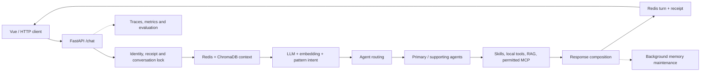

# EchoMind

**A multi-agent customer support application with explicit routing, knowledge access, memory, and evaluation.**

Python 3.12 · FastAPI · Vue 3 · Redis · ChromaDB · MCP · Prometheus

[简体中文](README.zh-CN.md)

EchoMind is my end-to-end project for support requests that do not fit neatly into one chatbot prompt. A customer can report a login error, a duplicate charge, or both in the same message. The application identifies the request, assigns appropriate support roles, controls their access to rules and tools, and carries relevant context into the next turn. Its Vue interface brings chat, knowledge management, and evaluation into one workspace.

The included policies and customer examples are illustrative. EchoMind can collect billing details and prepare a human handoff; actual order lookups, refunds, and ticket creation require integration with the relevant business systems.

In development mode, an empty knowledge base can be seeded with six clearly labeled fictional policies so the retrieval flow is ready to explore. Set `ECHOMIND_SEED_DEMO_DOCS=false` to start with an empty collection. Production mode does not seed these documents.

## Language

The Vue interface defaults to **English** for a new visitor and can switch to **中文** at any time. The choice is stored in the browser and survives a refresh. Navigation, forms, examples, empty states, and the evaluation, monitor, and trace labels come from one frontend dictionary. Errors returned by the backend may keep their original detail for diagnosis; the surrounding status is localized.

`POST /chat` accepts an optional `locale` of `en` or `zh-CN`, defaulting to `zh-CN` for existing clients. The selection is passed to the Agent as an output-language requirement for the final user-facing reply, including single-agent, composed, escalation, clarification, and failure replies. This is a runtime instruction, not a model-independent guarantee; validate the actual reply language with your configured model provider. English questions use a small set of English intent examples and keywords, but still rely on the existing Chinese Skills, routing rules, and knowledge base. When an English query needs retrieval, the query rewrite can produce Chinese sub-queries so it can find the Chinese demo policies; if the rewrite model is unavailable, a small English-to-Chinese term map (for example address → 地址) is used only as a recall fallback. These retrieval paths do not translate stored documents; the Agent still writes the final reply in the selected language. Deploy the frontend and backend together: an older backend ignores the optional `locale` fields and returns Chinese, so a new English UI could otherwise appear to receive Chinese replies.

Not everything is translated. Machine fields (`intent`, `agent_type`, `status`, `error_code`, tool names, metric names), Skill names and bodies, knowledge excerpts shown in search, uploaded documents, external MCP text, and the built-in evaluation cases, Judge, and baselines remain in their original form. Switching language in the UI starts a new conversation so that previous-language history does not drive the new reply; existing server-side conversations, user profiles, and knowledge are not deleted. If a browser has a saved conversation but no saved language (for example, from an older version), the UI also starts a new conversation so the first reply uses the selected language.

Cross-language retrieval is relevance-based: a smaller `top_k` may omit useful excerpts, and result order can vary. The application does not treat a retrieved excerpt as proof that an account, order, or payment action occurred.

Invalid locale values are rejected with a `400` response. Omitting `locale` preserves the original Chinese behavior.

## At a glance

| Area | What is implemented |
| --- | --- |
| Intent understanding | LLM classification, embedding similarity, and pattern rules contribute to a structured intent, domain, urgency, entities, and source scores. |
| Agent orchestration | General, Technical, and Billing roles handle their respective requests. Mixed requests can use a primary and supporting role in parallel before one answer is composed. Human escalation follows an explicit handoff path. |
| Rules and tools | Markdown Skills supply role-specific procedures. Code controls tool permissions, schema validation, timeouts, caching, circuit breaking, and appropriate fallbacks. |
| Knowledge and MCP | ChromaDB stores shared knowledge. Agents request retrieval when useful; configured external MCP tools are filtered by allowlist and role. EchoMind also exposes its local knowledge tool through MCP. |
| Conversation memory | Redis holds recent turns, task state, locks, and request receipts. ChromaDB supports retrieval of past episodes and user profiles. |
| Observation and evaluation | Request traces, runtime statistics, Prometheus metrics, asynchronous evaluation jobs, LLM-as-Judge scoring, and regression baselines support inspection and iteration. |

## How a request moves



The API checks identity, request reuse, and conversation order before reading recent messages and relevant longer-term context. Intent recognition supplies structured input for routing. The chosen role then decides whether it needs a local tool, shared knowledge, or a permitted external MCP tool. The reply and request receipt are committed together; longer-term memory maintenance follows in the background.

**Intent recognition does not pre-fetch knowledge for every message.** Retrieval happens when an Agent asks for it, so a greeting, clarification, or handoff request does not pay for an unnecessary search.

### Example situations

| Customer says | EchoMind's path |
| --- | --- |
| “Login returns HTTP 401. What should I check?” | Route to Technical, combine its diagnostic Skill with the error-code tool, and ask for the details needed to narrow the cause. |
| “I was charged twice. The amount was 99.” | Billing collects the relevant fields and can carry the amount into a follow-up. Collected fields do not imply that a transaction has been verified. |
| “I cannot log in, and I was charged twice.” | Use primary and supporting roles for the technical and billing parts, then compose one answer. |
| “Please connect me to a person.” | Take the explicit escalation path and prepare a handoff summary. |

## Run locally

You need Docker with Compose v2 and a model endpoint that supports the **Anthropic Messages protocol and tool calls**. The first build downloads container images, Python dependencies, and the embedding model used by ChromaDB.

1. Create a private configuration file from the example:

   ```bash
   cp backend/.env.example backend/.env
   ```

2. Edit `backend/.env`. Provide your `ANTHROPIC_API_KEY`, a model ID your provider actually offers in `ANTHROPIC_MODEL`, the appropriate `ANTHROPIC_BASE_URL`, and your own random `REDIS_PASSWORD`. The example uses a DeepSeek-compatible URL; leave the base URL empty for the official Anthropic endpoint. Do not commit `backend/.env`.

3. Start the stack from the repository root:

   ```bash
   docker compose --env-file backend/.env up -d --build
   docker compose --env-file backend/.env ps
   ```

| Local address | Purpose |
| --- | --- |
| [localhost:5174](http://localhost:5174) | Vue application; its default `/api/python` path proxies to the API |
| [localhost:8000/docs](http://localhost:8000/docs) | FastAPI documentation |
| [localhost:8000/health](http://localhost:8000/health) | Initialization check |
| [localhost:9090](http://localhost:9090) | Prometheus |

A healthy API confirms initialization. It does not prove that a model key, model ID, quota, or tool-calling capability is correct; those are exercised by a chat or another model-backed request.

Try the API directly:

```bash
curl -X POST http://localhost:8000/chat \
  -H 'Content-Type: application/json' \
  -d '{"message":"Login returns HTTP 401. What should I check?","user_id":"demo-user","conv_id":"demo-conversation","client_request_id":"turn-001","locale":"en"}'
```

Keep `conv_id` for a follow-up and choose a **new** `client_request_id` for each new message. The same request ID with the same text retrieves its receipt; reusing it with different text or a different `locale` is rejected. Remove `locale` to use the original `zh-CN` behavior.

To stop the stack while keeping its data:

```bash
docker compose --env-file backend/.env down
```

`down -v` deletes the named data volumes. If the default host ports are occupied, set `ECHOMIND_API_HOST_PORT`, `ECHOMIND_WEB_HOST_PORT`, or `ECHOMIND_PROM_HOST_PORT` in `backend/.env`.

### Frontend development

With the Python API running on local port 8000:

```bash
cd frontend
npm ci
npm run dev
```

Vite serves the UI on [localhost:5173](http://localhost:5173) and proxies `/api/python` to the API. Set `VITE_PYTHON_API_URL` if the API is elsewhere.

## Why these pieces exist

**Three signals for intent.** An LLM handles varied phrasing; embedding similarity and patterns add more stable signals for known categories. The fused score is support for a routing decision, not a calibrated probability or an accuracy claim. Low support can lead to clarification.

**Skills and knowledge serve different purposes.** Skills describe *how* a role should handle a request. The knowledge base stores *what* the application currently knows about a policy or product. Skills are loaded as prompt text; tool authorization and argument validation remain in code.

The [Skills guide](backend/skills/README.md) shows the file format and reload endpoint.

**Two stores match different memory lifetimes.** Redis manages recent turns, current task fields, locks, and retry receipts. ChromaDB makes past episodes and profiles searchable. The stores are not one atomic transaction: the current turn commits first, and longer-term maintenance runs afterward.

**Tool access has an explicit boundary.** Model-proposed arguments are validated against schemas. A remote MCP server exposing a tool does not automatically grant it to every Agent. Timeouts, caching, circuit breaking, and request traces make failure and recovery easier to inspect.

**Evaluation checks answer quality.** HTTP success or a successful tool call does not establish a good answer. The evaluation path exercises intent classification and Agent responses, records Judge dimensions, and compares saved baselines after changes to prompts, tools, or models. The built-in cases, Judge prompts, and baselines are internal Chinese materials; switching the interface language does not create an English suite or a second baseline.

## API and configuration

| Endpoint | Purpose |
| --- | --- |
| `POST /chat` | Conversation flow, follow-ups, and same-message retry receipts; optional `locale` (`en` / `zh-CN`, default `zh-CN`) |
| `POST /search`, `POST /knowledge/add`, `POST /knowledge/upload` | Search, import, or upload shared knowledge; `/search` accepts an optional `locale` for cross-lingual query rewriting |
| `GET /skills`, `POST /skills/reload` | Inspect and reload role procedures |
| `GET /monitor`, `GET /metrics` | Runtime view and Prometheus metrics; `/monitor` accepts an optional `locale` for fixed feedback |
| `POST /eval/run`, `GET /eval/jobs/{job_id}` | Submit and inspect asynchronous evaluations (Chinese cases and baseline) |

| Setting | Purpose |
| --- | --- |
| `ANTHROPIC_API_KEY`, `ANTHROPIC_MODEL`, `ANTHROPIC_BASE_URL` | Model service key, supported model ID, and optional compatible endpoint |
| `REDIS_PASSWORD` | Shared password for Redis and the API connection in Compose |
| `INTENT_EMBEDDING_PROVIDER`, `SILICONFLOW_API_KEY` | Optional online intent embeddings; local similarity works without a second key |
| `MCP_EXTERNAL_ENABLED` | External MCP switch; the sample configuration allows read-only Microsoft Learn documentation tools |
| `ECHOMIND_ENV`, `ECHOMIND_API_TOKENS` | Local development mode or application access tokens for deployment |

Compose binds its published ports to `127.0.0.1` by default. Access from other machines calls for HTTPS and application tokens. The current knowledge base is shared: user-separated conversations do not imply tenant-separated documents. One application process is the recommended deployment because evaluation jobs, some routing state, and caches are held in process memory.

## Repository map

```text
backend/api/          HTTP API and application lifecycle
backend/agents/       Agent roles, routing and response composition
backend/core/         Intent, task state, concurrency and access control
backend/tooling/      Knowledge retrieval, tool management and MCP
backend/memory/       Redis and ChromaDB memory
backend/monitor/      Runtime statistics and Prometheus metrics
backend/evaluation/   Intent, dialog and regression evaluation
backend/skills/       Editable role procedures
backend/tests/        Unit and integration checks
frontend/src/         Vue UI, API client and request state
compose.yaml          Local stack
```

## Tests

```bash
# Frontend
cd frontend
npm ci
npm test
npm run build
cd ..

# Backend (Python 3.12)
cd backend
python3.12 -m venv .venv
source .venv/bin/activate
pip install -r requirements-dev.txt
python -m pytest -q
```

The unit tests use controlled inputs. Model behavior also depends on the configured provider; the Redis and ChromaDB integration scripts require those services to be running.
