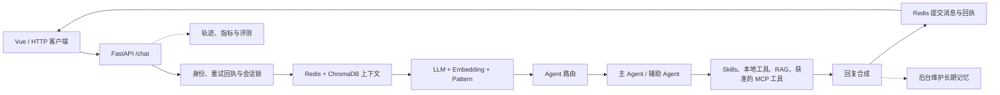

# EchoMind

**一个把意图识别、Agent 协作、知识检索、会话记忆和评测接成完整链路的客服应用。**

Python 3.12 · FastAPI · Vue 3 · Redis · ChromaDB · MCP · Prometheus

[English](README.md)

EchoMind 是我围绕客服与运营请求构建的多 Agent 应用。一个用户可能同时遇到登录错误和重复扣款；如果只把整段话交给单个聊天模型，角色分工、工具权限、追问中的上下文以及处理质量都不容易讲清楚。EchoMind 把这些环节拆成可观察、可调整的处理链路，并提供 Python/FastAPI 后端和 Vue 前端。

项目覆盖产品咨询、登录故障、退款与账单核验、跨领域问题及转人工等场景。它提供的是处理和核验流程：真实订单查询、退款执行、工单创建等操作需要再接入对应业务系统。

开发模式下，空知识库可自动导入六篇明确标注为虚构示例的政策，用于体验检索链路。设置 `ECHOMIND_SEED_DEMO_DOCS=false` 可从空库开始；生产模式不会自动导入这些资料。

## 可以从哪里看起

- 想体验应用：按[本地启动](#本地启动)运行，然后在网页中尝试“登录报 401，而且刚才重复扣款了”。
- 想理解设计：看[一条请求如何处理](#一条请求如何处理)和[关键设计选择](#关键设计选择)。
- 想看实现：从 `backend/api/main.py` 的 `/chat` 入口，接到 `core/intent_recognizer.py`、`agents/agent_orchestrator.py` 和 `memory/conversation_memory.py`。

## 项目能力

| 模块 | 设计与作用 |
| --- | --- |
| 意图识别 | LLM、Embedding 和 Pattern 规则共同提供候选，输出领域、细粒度意图、紧急度、实体和来源分数。融合结果用于路由，不把它冒充准确率。 |
| Agent 编排 | General、Technical、Billing 分别处理通用、技术与账单问题；复合请求可由主辅 Agent 并行处理，之后合成一次回复。人工升级有明确的交接路径。 |
| Skills 与工具 | 从 Markdown 加载角色处理规范；工具层执行参数校验、超时、缓存、熔断与适当的失败降级。角色能使用哪些工具由代码控制。 |
| 知识库与 MCP | ChromaDB 存储共享知识资料，Agent 按需检索；外部 MCP 工具按白名单和角色过滤，本地知识检索也可作为 MCP 服务提供。 |
| 分层记忆 | Redis 管理近期对话、当前任务字段与重试回执；ChromaDB 保存情景记忆和用户画像。 |
| 监控与评测 | 请求轨迹、运行统计和 Prometheus 指标用于排查；异步评测覆盖意图分类、对话质量、LLM-as-Judge 与回归基线。 |

## 一条请求如何处理



入口先确认身份、会话顺序及是否为重复请求，再读取近期消息与相关长期记忆。意图识别把问题变成路由所需的结构化信息；路由器选择单个 Agent、主辅协作、澄清或升级。Agent 执行期间可以按需调用工具，完成后将回复与本轮消息一起提交，并留下可查询的回执和轨迹。

**意图识别不会对每条消息预先检索知识库。** 选中的 Agent 在需要资料时调用共享知识工具。因此问候、澄清或转人工请求不必承担无意义的检索开销。

### 典型场景

| 用户提出 | 系统如何处理 |
| --- | --- |
| “登录返回 HTTP 401，怎么排查？” | 路由给 Technical，结合排障 Skill 和错误码工具组织核查步骤。 |
| “我被扣了两次钱，金额是 99 元。” | Billing 收集必要字段；后续追问可沿用当前任务状态，但不会把字段齐全误当成交易已核实。 |
| “登录失败，而且刚才重复扣款了。” | 选择主辅 Agent 协作，分别处理技术与账单线索，再合成一次回复。 |
| “请转人工。” | 进入明确的升级路径，形成可交接的摘要。 |

## 本地启动

需要 Docker、Compose v2，以及支持 **Anthropic Messages 协议和工具调用**的模型服务。首次构建会下载容器镜像、Python 依赖及 ChromaDB 使用的 Embedding 模型。

1. 在仓库根目录创建私有配置文件：

   ```bash
   cp backend/.env.example backend/.env
   ```

2. 编辑 `backend/.env`：填写实际的 `ANTHROPIC_API_KEY`、服务商提供的 `ANTHROPIC_MODEL`、适用的 `ANTHROPIC_BASE_URL`，并把 `REDIS_PASSWORD` 换成自己的随机值。模板中的 DeepSeek 兼容地址只是示例；使用 Anthropic 官方接口时可留空 Base URL。`.env` 不应提交到版本控制。

3. 启动服务：

   ```bash
   docker compose --env-file backend/.env up -d --build
   docker compose --env-file backend/.env ps
   ```

| 本机地址 | 用途 |
| --- | --- |
| [localhost:5174](http://localhost:5174) | Vue 页面，默认经同源 `/api/python` 路径访问后端 |
| [localhost:8000/docs](http://localhost:8000/docs) | FastAPI 接口文档 |
| [localhost:8000/health](http://localhost:8000/health) | 后端初始化状态 |
| [localhost:9090](http://localhost:9090) | Prometheus |

`/health` 成功只说明应用完成初始化。发送聊天请求才能验证模型 Key、模型 ID、额度和工具调用支持是否正确。网页顶部会显示当前连接状态，连接设置可调整服务地址、用户与会话。

也可以直接发出第一条消息：

```bash
curl -X POST http://localhost:8000/chat \
  -H 'Content-Type: application/json' \
  -d '{"message":"登录返回 HTTP 401，怎么处理？","user_id":"demo-user","conv_id":"demo-conversation","client_request_id":"turn-001"}'
```

同一会话的追问沿用 `conv_id`，每条新消息使用新的 `client_request_id`。同一请求 ID 配合同一消息用于重试；换了消息却复用 ID 会被拒绝，避免把旧回复误当成新结果。

停止服务时保留数据：

```bash
docker compose --env-file backend/.env down
```

普通 `down` 保留 Redis、ChromaDB 和应用数据卷；`down -v` 会删除这些数据卷，不适合作为日常停止命令。如果本机已有程序占用 8000、5174 或 9090 端口，可在 `backend/.env` 中分别设置 `ECHOMIND_API_HOST_PORT`、`ECHOMIND_WEB_HOST_PORT`、`ECHOMIND_PROM_HOST_PORT`。

### 单独运行前端

后端已运行时，也可从 `frontend/` 执行：

```bash
npm ci
npm run dev
```

Vite 在 [localhost:5173](http://localhost:5173) 提供页面，将 `/api/python` 代理到本机 8000 端口。后端位于其他地址时，可设置 `VITE_PYTHON_API_URL`。

## 关键设计选择

**三路意图识别。** LLM 理解多样表达，Embedding 相似度和 Pattern 为已知类别提供更稳定的信号。融合分数用于比较路由支持度，不是经过校准的概率，也不等于分类准确率。支持度不足时可以先澄清。

**Skills 与知识库分开。** Skills 描述“这一类问题应怎样处理”，知识库存放“当前业务事实和政策是什么”。前者是可加载的提示词文本，不能代替代码中的工具授权和参数检查；后者由 Agent 在需要时调用。

[Skills 使用说明](backend/skills/README.md)列出了文件格式与热加载接口。

**两种存储承担不同寿命的记忆。** Redis 负责近期消息、任务字段、锁和重试回执；ChromaDB 负责可检索的历史摘要和画像。本轮消息与回执先提交，长期记忆随后维护。两种存储之间没有跨库原子事务。

**工具调用有清晰的执行边界。** 模型提出的参数须通过 schema 校验；外部 MCP 服务公开了工具，也不意味着所有 Agent 都可调用。超时、缓存、熔断和请求轨迹让失败和恢复更容易分析。

**评测覆盖回答质量。** HTTP 成功或工具执行成功不能证明答案好。项目把意图分类、Agent 回复、Judge 评分和回归比较接在应用链路上，以便在改动规则、工具或模型后进行检查。

## 接口与配置

| 入口 | 用途 |
| --- | --- |
| `POST /chat` | 聊天主链路；支持同一会话的追问和同一消息的重试回执 |
| `POST /search`、`POST /knowledge/add`、`POST /knowledge/upload` | 搜索、导入或上传共享知识资料 |
| `GET /skills`、`POST /skills/reload` | 查看和重新加载角色规范 |
| `GET /monitor`、`GET /metrics` | 运行监控与 Prometheus 指标 |
| `POST /eval/run`、`GET /eval/jobs/{job_id}` | 提交和查看异步评测 |

| 配置 | 作用 |
| --- | --- |
| `ANTHROPIC_API_KEY`、`ANTHROPIC_MODEL`、`ANTHROPIC_BASE_URL` | 模型服务密钥、实际支持的模型 ID 和可选兼容地址 |
| `REDIS_PASSWORD` | Compose 中 Redis 与后端共用的密码 |
| `INTENT_EMBEDDING_PROVIDER`、`SILICONFLOW_API_KEY` | 可选的在线意图向量；未配置第二个 Key 时可用本地相似度 |
| `MCP_EXTERNAL_ENABLED` | 外部 MCP 连接开关；示例配置为只读 Microsoft Learn 文档工具 |
| `ECHOMIND_ENV`、`ECHOMIND_API_TOKENS` | 本机开发模式或部署时的应用访问 Token |

默认 Compose 端口只绑定 `127.0.0.1`。需要从其他机器访问时，应配置 HTTPS 和应用 Token。当前知识库是共享库：会话按用户区分，并不等于知识资料具有租户级权限。评测任务、部分路由状态和缓存保存在应用进程内，因此推荐单应用进程部署。

## 代码结构

```text
backend/api/          HTTP API 与应用初始化
backend/agents/       Agent 角色、路由与回复合成
backend/core/         意图识别、会话状态、并发与访问控制
backend/tooling/      知识检索、工具管理与 MCP
backend/memory/       Redis 与 ChromaDB 记忆
backend/monitor/      运行统计与指标
backend/evaluation/   意图、对话与回归评测
backend/skills/       可编辑的业务处理规范
backend/tests/        单元与集成检查
frontend/src/         Vue 页面、API 客户端与请求状态
compose.yaml          本地服务编排
```

## 开发检查

前端：

```bash
cd frontend
npm ci
npm test
npm run build
cd ..
```

后端在 Python 3.12 环境中：

```bash
cd backend
python3.12 -m venv .venv
source .venv/bin/activate
pip install -r requirements-dev.txt
python -m pytest -q
```

单元测试使用受控输入；真实模型回复还取决于所配置的服务。涉及 Redis、ChromaDB 的集成脚本需要先启动相应服务。
